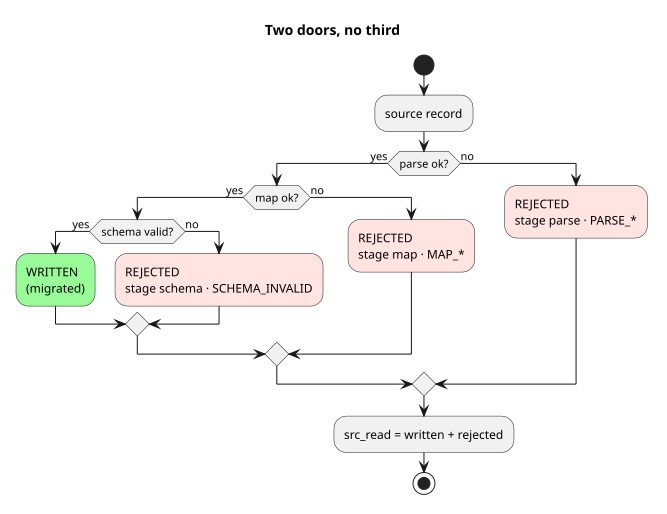

# ETL-R: verifiable migration, three implementations

**What is the simplest migration you can trust?** One that counts.

**Every source record is accounted for.** A record arrives in the Target System,
or it is rejected with a named reason. `src_read = written + rejected`.
A run that does not balance **fails**.

**Built three ways, measured on real GCP.** One full GCP session cost $0.90 to $2.33, from build to teardown.
At 200,000 records, most of the run time is start-up, not processing.

**Proof at the target:** the Target System confirmed 200,000 of 200,000 records in each 200k run.
[See it balance](#every-record-counted-none-lost).

ETL-R is [ETL](https://en.wikipedia.org/wiki/Extract,_transform,_load) plus
[**R**econciliation](https://www.linkedin.com/pulse/automating-post-load-reconciliation-suhas-vivek-cxj1c/):
the step that proves the count.
Each batch run reads a full snapshot of the Source System.
It loads the Target System through Kafka. A record sent twice is stored once.
One spec in [`spec/`](spec/PIPELINE.md), three implementations.
A test oracle, the expected output written down before any run, checks every row.

## Choose by evidence, not opinion

**This repo has one goal: to show, with measured evidence, which implementation to choose.**
Each ran on real GCP, one after another, with the same inputs:
a 55-record test file with 5 seeded defects, then 200,000 records.

| Lower is better | `flink` | `flink-jdbc` | `beam-dataflow` |
|---|---|---|---|
| GCP resources to create and operate | **71** | 81 | 75 |
| Ramp-up: build the infrastructure | 23 min 36 s | **14 min 25 s** | 50 min 56 s ² |
| 200k run | 6 min 55 s | **5 min 59 s** | 38 min 25 s ¹ |
| Ramp-down: tear it down | 16 min 56 s | **14 min 40 s** | 18 min 36 s |
| Total GCP time ³ | 59 min 31 s | **56 min 45 s** | 2 h 31 min |
| Cost (estimate) | **$0.90** | $0.94 | $2.33 |

¹ One retry: the Target System mock lost its Kafka login. Without it, about 28 min.<br>
² About 10 min lost to a hung build script.<br>
³ Also includes the 55-record run and the pauses between steps.

**Pick a Flink implementation.** Beam's stack cost about 2.5 times as much here.
Most of the gap is fixed cost: Composer, Google's managed Airflow, alone is $1.03.
The trade-off: Flink needs a GKE cluster you operate. Google manages Dataflow and Composer.
Between the two Flink implementations, the source decides:

- Files: `flink`.
- A Postgres database: `flink-jdbc`.

**How it was measured.**

- One run each, in `europe-west1`, at small sizes.
- Flink: 3 batch jobs, parallelism 1, on one 4-vCPU GKE node. Dataflow: 3 batch jobs, one 1-vCPU worker each.
- Times exclude preparing the input.
- At 200,000 records, start-up dominates. Dataflow's own processing cost about 3 cents of Beam's $2.33.
- Each implementation splits the eight stages differently: [how each maps them](docs/diagrams/08-stage-mapping.svg).
- The Target System is a mock on Cloud Run. It confirms each record it stores.
- Cost is [an estimate from list prices](docs/evidence/cost-estimate.md), not an invoice.

**Every run balanced.**

- `flink` and `beam-dataflow`: `200,005 = 200,000 + 5`.
- `flink-jdbc`: `200,003 = 200,000 + 3`. It reads a database, not a file.
  Rows with a bad date or number cannot be stored there. So its source holds 200,003 records.

The numbers and the raw evidence are in [`docs/evidence/`](docs/evidence/README.md).

## Every record counted, none lost

A migration can move millions of records. A lost one is easy to miss.
Every record leaves through one of two doors.



**See it balance.** The reconciliation report of the 200k `flink` run, abridged from
[`recon-run-200k-20261022.json`](docs/evidence/gcp-flink-20261022/recon/recon-run-200k-20261022.json):

```json
{
  "runId": "run-200k-20261022",
  "ok": true,
  "balance": { "srcRead": 200005, "written": 200000, "rejected": 5, "balanced": true },
  "stages": [
    { "stage": "intake", "lhs": 200005, "rhs": 200005, "holds": true,
      "equation": "account_src + parse rejects = src_read" },
    { "stage": "produce", "lhs": 200002, "rhs": 200002, "holds": true,
      "equation": "account_target + map/schema rejects = account_enriched" }
  ],
  "settle": { "targetRows": 200000, "confirmed": 200000, "unconfirmed": [] }
}
```

`settle` is the Target System's own count: every written record, confirmed.
Each rejected record is named in `reject_log` with its reason, and traced in `record_lineage`:
`PARSE_BAD_COLUMN_COUNT`, `PARSE_BAD_NUMERIC`, `PARSE_BAD_DATE`, `MAP_UNMAPPED_ENUM_VALUE`, `SCHEMA_INVALID`.

## Three implementations, one spec

| Implementation | Stack | Picture |
|---|---|---|
| [`implementations/flink/`](implementations/flink/) | Flink 2.2 SQL + DataStream (Java), Postgres, Kafka | [containers](docs/diagrams/flink/c2-containers.svg) |
| [`implementations/flink-jdbc/`](implementations/flink-jdbc/) | Flink 2.2 (Java) reading the Source System's Postgres | [containers](docs/diagrams/flink-jdbc/c2-containers.svg) |
| [`implementations/beam-dataflow/`](implementations/beam-dataflow/) | Beam 2 (Python) on Dataflow, Dataform, Composer | [containers](docs/diagrams/beam-dataflow/c2-containers.svg) |

All three run the same eight stages: `extract gate intake curate enrich produce load recon`.

**Extend, never rewrite.** A new project adds contracts: record layouts, mappings and schemas.
Implementation code stays untouched.

More: [overview](docs/diagrams/00-overview.svg) ·
[pipeline flow](docs/diagrams/02-pipeline-flow.svg) ·
[conformance](docs/diagrams/10-conformance-sequence.svg) ·
[data model](docs/diagrams/09-data-model.svg) ·
[deployment](docs/diagrams/11-deployment.svg) ·
[extend, not rewrite](docs/diagrams/14-extend-not-rewrite.svg) ·
[all diagrams](docs/diagrams/README.md)

## Prove it on GCP

One runbook covers all three implementations: [`docs/runbook-gcp.md`](docs/runbook-gcp.md).
These runs are billable. Each creates the infrastructure, runs the 55-record test file, then tears it down.
One recorded run of each is in [`docs/evidence/`](docs/evidence/README.md).

## Prove it on your laptop (uses only the small fixture and no 200k run)

```
make spec-test          # the comparator's own tests
make conformance-all    # every implementation vs. the oracle, row for row
```

The comparator, [`spec/conformance/compare.py`](spec/conformance/compare.py), fails on any difference.
`make spec-test` needs only [`uv`](https://docs.astral.sh/uv/).
`make conformance-all` also needs Java 17, Maven, podman and podman-compose.
Beam adds GnuPG, for its encrypted extract, and Node, for Dataform.
Run `make -C implementations/beam-dataflow bootstrap` once first. **No GCP account, no billing.**
Per-implementation commands: [`docs/runbook-gcp.md`](docs/runbook-gcp.md).

## License

[MIT](LICENSE).
