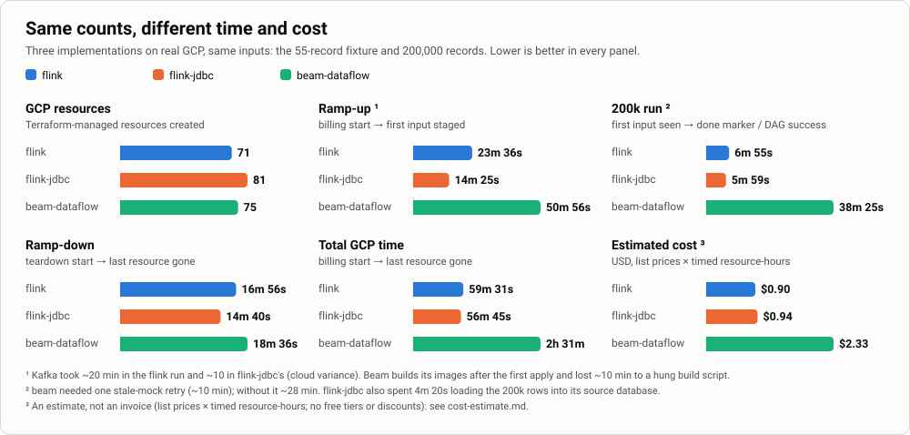

# flink or flink-jdbc: choose by measured time and cost

Three implementations ran on real GCP, **one after another**, with the same two inputs:
the 55-record fixture and 200,000 records. All three balanced both runs. The numbers decide.

| Measure | `flink` | `flink-jdbc` | `beam-dataflow` |
|---|---|---|---|
| **GCP resources** (Terraform-managed) | **71** | 81 | 75 |
| **Ramp-up** (billing start → first input staged) | 23 min 36 s | **14 min 25 s** | 50 min 56 s |
| **200k run** (first input seen → done) | 6 min 55 s | **5 min 59 s** | 38 min 25 s |
| **Ramp-down** (teardown start → last resource gone) | 16 min 56 s | **14 min 40 s** | 18 min 36 s |
| **Total GCP time** (billing window) | 59 min 31 s | **56 min 45 s** | 2 h 31 min |
| **Estimated cost** | **$0.90** | $0.94 | $2.33 |

Bold is the best value in the row. Cost is an estimate, not an invoice: [`cost-estimate.md`](cost-estimate.md).

## What the numbers say

- **The two Flink implementations are close.** `flink-jdbc` wins on time. `flink` wins on cost by $0.04 and on resource count by 10.
- **Beam is slower at every step and costs about 2.5 times as much.** Composer alone is $1.03.
- **Kafka decides the Flink ramp-up.** It took about 20 min in the `flink` run and about 10 in `flink-jdbc`. That is cloud variance, not design.
- **Beam's 200k run includes one retry.** A stale mock login failed `load` closed. Without the retry it is about 28 min.
- **`flink-jdbc` also spent 4 min 20 s loading 200,000 rows into its source database.** That ran before its 5 min 59 s run.
  It counts in its total GCP time, not in its run time.
- **All three are correct.** Every record is accounted for. 200,000 of 200,000 are confirmed in each run.

## How each measure is defined

| Measure | Definition |
|---|---|
| Resources | Terraform-managed resources. The state bucket and the 16 API enablements are excluded. |
| Ramp-up | First `terraform apply` → first input staged or loaded. |
| 200k run | Run start (Flink: input discovered; Beam: DAG triggered) → run done. |
| Ramp-down | Teardown start → last resource gone, checked by resource type. |
| Total GCP time | Billing start → last resource gone. |
| Cost | List price × timed quantity, per SKU. |

## Small sizes, one run each

| As deployed | `flink` | `flink-jdbc` | `beam-dataflow` |
|---|---|---|---|
| Processing | GKE, 1 × e2-standard-4 node (autoscale 1–3) | same | Dataflow, 1 worker with 1 vCPU per job |
| Jobs | 3 Flink jobs, parallelism 1 | same | 3 Dataflow jobs per run, plus Dataform |
| Flink pods | JobManager 1 vCPU / 1 GiB, TaskManager 1 vCPU / 2 GiB | same | none |
| Orchestration | Cloud Run job, triggered every minute | same | Composer 2 Small: scheduler, web server, 1–3 workers |
| Database | Cloud SQL Postgres 16, 1 vCPU / 3.75 GB | two of these: source and pipeline | BigQuery |
| Kafka | Managed Kafka, 3 vCPU / 3 GiB | same | same |
| Target System mock | Cloud Run, 1 vCPU / 512 MiB | same | Cloud Run, 1 vCPU / 2 GiB |

**At 200,000 records, start-up dominates.** Each Flink job pays its own start-up.
Dataflow's own processing cost about 3 cents of Beam's $2.33.
The times compare whole stacks at small sizes, not engine throughput.
Sources: `infra/inventory.txt` and `gcp/D3-infra-inventory.txt` in the packs, the Flink job templates, the Dataflow job metrics.

## Every run balanced

| | `flink` | `flink-jdbc` | `beam-dataflow` |
|---|---|---|---|
| Fixture | 55 = 50 + 5, 50 / 50 confirmed | 53 = 50 + 3, 50 / 50 confirmed | 55 = 50 + 5, 50 / 50 confirmed |
| Oracle on the fixture | 68 / 68 | 46 / 46, typed-source oracle | 68 / 68 |
| 200k | 200,005 = 200,000 + 5 | 200,003 = 200,000 + 3 | 200,005 = 200,000 + 5 |
| 200k confirmed | 200,000 | 200,000 | 200,000 |

`flink` and `beam-dataflow` rejected the same five seeded defects, with the same reasons.
`flink-jdbc` reads a typed database. It refuses the bad-numeric and bad-date rows at load time.
Its pipeline rejected the other three: `PARSE_MISSING_FIELD`, `MAP_UNMAPPED_ENUM_VALUE`, `SCHEMA_INVALID`.

## What went wrong, recorded

- **A stale mock.** The Target System mock's Kafka login goes stale after about 34 min. The `load` step then fails closed
  (`unsettled=N`, `RECONCILIATION FAILED`). Recycling the Cloud Run revision fixed it, and the retry passed.
  It happened in `flink-jdbc` (fixture) and twice in `beam-dataflow`. Nothing was lost silently.
- **A hung build script** cost Beam about 10 min of ramp-up.
- **Cloud SQL's peering** refused to delete, in both Flink implementations. The runbook has the fallback.

## The packs

| Pack | What is in it |
|---|---|
| [`gcp-flink-20261022/`](gcp-flink-20261022/README.md) | Timeline, logs 01–21, orchestrator log, recon reports, Cloud SQL dumps, inventory |
| [`gcp-flink-jdbc-20261022/`](gcp-flink-jdbc-20261022/README.md) | The same, plus the source-read proof and the control row |
| [`gcp-beam-dataflow-20261022/`](gcp-beam-dataflow-20261022/README.md) | Deep dive: laptop and GCP runs, every hop, four figures |

Identifiers (project, account, URLs, bucket hashes) are replaced with placeholders.
Every pack was redacted by a script that refuses to publish if anything sensitive survives.

## Limits

- **One run per implementation.** Cloud timing varies. Kafka alone moved the ramp-up by 10 min.
- **One region** (`europe-west1`), one machine size per implementation, as the Terraform defines them.
- **No console screenshots.** Google blocks sign-in inside an automated browser. The data can be re-checked instead.
