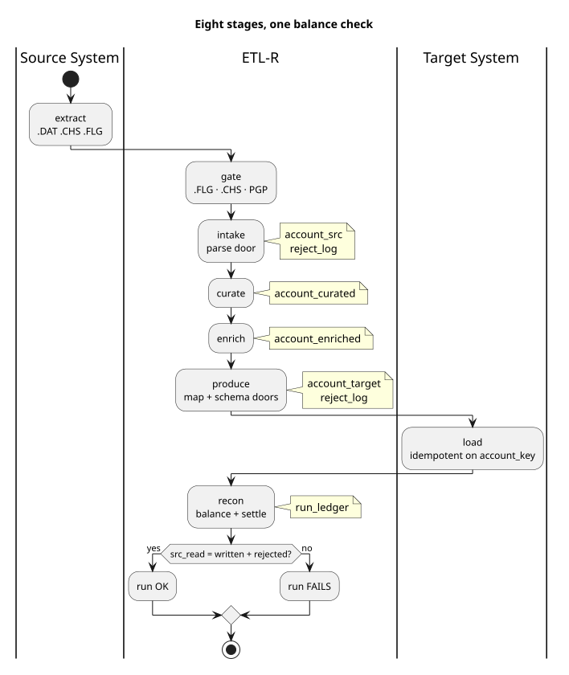

# The pipeline, defined once

What every implementation under `implementations/` must do. Implementations read `spec/` by path.
The oracle in `fixtures/` proves they comply.



Diagrams: [two doors](../docs/diagrams/03-two-doors.svg) ·
[stage mapping](../docs/diagrams/08-stage-mapping.svg) ·
[data model](../docs/diagrams/09-data-model.svg) ·
[conformance](../docs/diagrams/10-conformance-sequence.svg)

## One run, one snapshot

A run migrates one full snapshot of Source System records into Target System.
**Every source record is accounted for.**

- The source is a TDS bundle (`beam-dataflow`, `flink`): pipe-delimited CSV with a header row.
- Or it is the Source System's own database (`flink-jdbc`). See [Source System as a database](#source-system-as-a-database).
- A run has a `run_id`. It is a bounded batch, and every write carries the `run_id`.
- A streaming mode is a defect.

## Two doors, no third

Every record leaves by exactly one door. Nothing is dropped. Nothing is counted twice.

| Door | Exit | Meaning |
|---|---|---|
| `written` | migrated | a valid Target System document |
| `rejected` | not migrated | stopped at a stage, with an enumerated reason |

```
src_read = written + rejected
```

A run that does not balance **fails**. The equation also closes per stage.

| Fixture | After `intake` | Whole lane |
|---|---|---|
| `beam-dataflow`, `flink` | `55 = 52 + 3` (parse rejects only) | `55 = 50 + 5` |
| `flink-jdbc` | `53 = 52 + 1` | `53 = 50 + 3` |

The `flink-jdbc` database refuses two of the 55 fixture rows before the run starts.

`run_ledger` holds a different tally per implementation.

| Implementation | Tally in `run_ledger` |
|---|---|
| `beam-dataflow` | intake: `55 / 52 / 3` (as the oracle) |
| `flink` | whole lane: `55 / 50 / 5` |
| `flink-jdbc` | intake: `53 / 52 / 1` |

All must balance. Conformance accepts either tally if it matches the manifest, and reports which it saw.

### Three checks, fixed order

Order is load-bearing: `parse → map → schema`.

| Stage | Reasons (a closed enum, never free text) |
|---|---|
| `parse` | `PARSE_SHORT_RECORD`, `PARSE_MISSING_FIELD`, `PARSE_BAD_NUMERIC`, `PARSE_BAD_DATE`, `PARSE_INVALID_JSON`, `PARSE_MISSING_JSON_PATH`, `PARSE_BAD_COLUMN_COUNT` |
| `map` | `MAP_MISSING_REQUIRED`, `MAP_UNKNOWN_TRANSFORM`, `MAP_UNMAPPED_ENUM_VALUE`, `MAP_TYPE_ERROR` |
| `schema` | `SCHEMA_INVALID` |

## Eight stages, fixed outputs

| Stage | Job | Output |
|---|---|---|
| `extract` | produce the bundle, `.FLG`, `.CHS` (another team's job; simulated here) | bundle |
| `gate` | needs `.FLG`; a `.CHS` mismatch fails with zero rows; decrypts PGP | verified input |
| `intake` | parse door | `account_src`, ledger row |
| `curate` | `account_src` → `account_curated` | `account_curated` |
| `enrich` | join reference data; decides nothing | `account_enriched` |
| `produce` | map and schema doors; batch; emit | `account_target`, target JSON or Kafka |
| `load` | publish to Target System, idempotent on the account key | Kafka `target-system-target` |
| `recon` | balance the equation; settle against confirmations | recon report |

`flink-jdbc` changes the first two. A control row replaces the bundle. The gate checks it by count and digest.

The spec fixes stages and outputs, not job granularity. One job may cover several stages, or the reverse.

## Names every implementation shares

| Thing | Name |
|---|---|
| Tables | `account_src`, `account_curated`, `account_enriched`, `account_target`, `reject_log`, `record_lineage`, `run_ledger` |
| Beam layout | BigQuery datasets `etlr_extraction`, `etlr_transformation`, `etlr_recon` |
| Flink layout | Postgres schemas with the same names |
| `flink-jdbc` extras | `etlr_source` (the source tables), `etlr_recon.source_read` |
| Kafka topics | `target-system-target`, `target-system-confirmations`, `target-system-rejections` |
| Service accounts | `loader-app`, `recon-service` (GCP needs ≥ 6 characters) |
| Shared columns | `_run_id`, `_account_key`, … declared in `contracts/artefacts.json` |

### Five artefacts

Both outer lanes write them under `{lane}/{run_id}/`: `extraction` on the way in, `load` on the way out.
`flink-jdbc` has no input artefacts. Its control row replaces `.FLG` and `.CHS`.

| Artefact | Name | What it is |
|---|---|---|
| `.DAT` | `{record}.{sequence}.DAT` | the data; zero-padded parts when large |
| `.CHS` | `{record}.CHS` | SHA-256 and record count per data file |
| `.ERR` | `{record}.ERR` | unreadable rows at extraction; failed documents at load |
| `.RPT` | `{record}.RPT` | the counts a side claims, from records actually read |
| `.FLG` | `{record}.FLG` | "all files complete"; written last, outside the encrypted bundle |

- `.CHS` lets recon catch corruption and truncation without re-reading the data.
- Well-formed but invalid records are not `.ERR` rows. They go through the doors.
- `.FLG` sits outside the bundle, so `gate` reads it without a decryption key.

## Five details parity hangs on

Verified against the oracle. Get one wrong and `reject_log` looks right and is wrong.

1. **`account_key`** = `sha256(key fields joined by \x1f)`, hex, first **32** characters.
   Example: `sha256("ACC000900003")[:32] = f3895bd9ae16e8e2626b578dff6f434b`.
2. **Content name** for a record too malformed to yield a key: `raw:` + `sha256(raw line)`, first **16** hex characters.
   Example: `4d5d9d96692584fa` for the truncated fixture row. It is sha256, not MD5.
3. **`source_key` differs by table.** In `reject_log` it is the **empty string** for parse rejects.
   In `record_lineage` it is the `raw:<hash>` content name.
4. **Parse walks the fields in TDS order.** The first failing field takes the blame.
   Missing column ⇒ `PARSE_BAD_COLUMN_COUNT`. Failed coercion ⇒ `PARSE_BAD_DATE` or `PARSE_BAD_NUMERIC`.
   Required and empty ⇒ `PARSE_MISSING_FIELD`. A global column-count check is wrong, even when the code matches.
5. **`detail` strings are part of the contract.** They are compared literally:

   ```
   CURRENCY needs column 4, row has 4
   OPEN_DATE='20191345'
   BALANCE='+0000000ABCD.56'
   status: 'X' not in ['A', 'C', 'D']
   accountId: 'acc-bad!0001' does not match '^[A-Z0-9]+$'
   ```

## Config, not code

`contracts/` is the only thing a new project edits. Implementation code does not change
([`contracts/README.md`](contracts/README.md)). `harness/` generates seeded input and packages
bundles ([`harness/README.md`](harness/README.md)).

## 55 records, one pinned answer

`ACCOUNT.src` is immutable: a header plus 55 records, sha256
`86f76332f08e7c8c0a0a78a4366fb124151f3467fbb3a68a556fd6461604426c`.

- `expected/*.tsv`: BigQuery dumps of the reference run, all seven tables.
- `manifest.json`: **55 read = 50 written + 5 rejected**, and the intake split `52 + 3`.
- The five seeded rejects, each with stage, reason and detail.

An implementation conforms when its tables match `expected/` row for row.

## Proof, row by row

```
python3 spec/conformance/compare.py <dump-dir> [--profile staged|single-pass]
```

`<dump-dir>` holds `<table>.tsv` for the seven tables of one run.

- Rows are compared, not counts. TARGET documents compare as JSON trees.
- Excluded: run identity (`run_id`, `_run_id`, `runId`) and wall-clock metadata.
- Column names ignore case. NULL, empty and `\N` are equal.

`make spec-test` proves the comparator fails on every kind of damage that matters.

| Profile | For | Change |
|---|---|---|
| `staged` (default) | implementations that materialise every layer | all seven tables compared |
| `single-pass` | implementations that route in one pass (Flink DataStream) | skips `account_src`, `account_curated`, `account_enriched` |

Under `single-pass`, map and schema rejects keep the original source line in `raw_record`.
The oracle holds the enriched row's JSON there. A single-pass job never builds it.

Every implementation **must** produce `reject_log`, `record_lineage`, `account_target` and `run_ledger`.
Only `staged` implementations produce the three intermediate layers.
Beam's input, `harness.generate --accounts 50`, is pinned byte-identical to `ACCOUNT.src`.

| Implementation | Command | Result |
|---|---|---|
| `flink` (SQL) | `make -C implementations/flink conformance` | 68 / 68, `staged` |
| `flink` (DataStream) | same command | 62 / 62, `single-pass` |
| `beam-dataflow` | `make -C implementations/beam-dataflow up init-infra conformance` | 68 / 68, `staged` |
| `flink-jdbc` | `make -C implementations/flink-jdbc conformance` | 46 / 46, `staged`, against `fixtures/db/` (`--expected fixtures/db/expected --manifest fixtures/db/manifest.json`) |

`make conformance-all` at the repo root runs the comparator's tests and all three implementations, locally.

Every implementation answers `make generate | run | test | conformance | verify`.
`verify` is implementation-defined. `conformance` means the same everywhere.

## Source System as a database

`flink-jdbc` reads the Source System's database, not a TDS bundle. Only these rules change.

**Source tables.**
- `etlr_source.account`: one typed column per TDS field (`DATE`, `NUMERIC(18,2)`, the rest `VARCHAR`).
  `acct_id` is the primary key. Every other column is nullable. Strings stay padded, as the source holds them.
- `etlr_source.extract_control`: one row per run: `run_id`, `table_name`, `ready_at`, `row_count`, `content_digest`.
- `harness/load_db.py` builds both from a TDS file. It refuses and lists any record a typed table cannot hold, and never rounds.
  Refused: a bad date, a bad numeric, a third decimal, an out-of-range numeric, an over-long value, extra columns, a key that repeats after TRIM.

**Canonical line.** One row as text.
- Fields in TDS order, joined by `|`. Strings untrimmed.
- `DATE` as `YYYY-MM-DD`. `NUMERIC` with exactly two decimals (`-` for negatives, no `+`). NULL as empty. UTF-8.
- A parse reject's `raw_record` is its canonical line. Its `record_lineage.source_key` is `raw:` + `sha256(canonical line)[:16]`.

**Content digest.**
- `part` = the integer value of the first 15 hex digits of `sha256(canonical line)`.
- `content_digest` = the exact sum of `part` over all rows. It is order-independent. A sum, not XOR, so duplicates count.
- It detects accidental change with probability ≈ 1 − 2⁻⁶⁰: the practical strength of `.CHS`, which is unsigned.
- It is blind to NULL ↔ `''`, and to a `|` moving across a field boundary.

**Gate and read check.**
- The gate refuses without a control row.
- It fails, with zero rows written, if count or digest differs, or a non-blank `TRIM(acct_id)` occurs twice.
- Intake measures count and digest over what it read (`etlr_recon.source_read`). `recon-jdbc` fails the run if they differ from the control row.

**Parse door.** Only `PARSE_MISSING_FIELD` can occur: a required NULL, or blank after TRIM.
`detail` is the field name, first in TDS order. The database refuses the other parse failures first:
`PARSE_BAD_DATE`, `PARSE_BAD_NUMERIC`, `PARSE_BAD_COLUMN_COUNT`, `PARSE_SHORT_RECORD`.

**Pinned values.**
- Truncated fixture row `ACC000900000` → canonical line `ACC000900000|CUS0000000|RETL|CUR001||||`.
- Content name `raw:bf47701944c6abec`. Part `861444277401316030`.
- The 53-row fixture → `content_digest 31503124396361923406`.

**Typed-source oracle (`fixtures/db/`).** `account.sql` (the fixture as typed rows), `expected/` and `manifest.json`.
`fixtures/db/derive.py` derives them from `fixtures/expected/`.
- Result: **53 read = 50 written + 3 rejected**: `PARSE_MISSING_FIELD` (`CURRENCY`), `MAP_UNMAPPED_ENUM_VALUE`, `SCHEMA_INVALID`.
- The database refuses `ACC000900001` and `ACC000900002`.
- **It is not independent evidence.** Everything except those facts is inherited from the BigQuery oracle. Those facts are rules written here.
